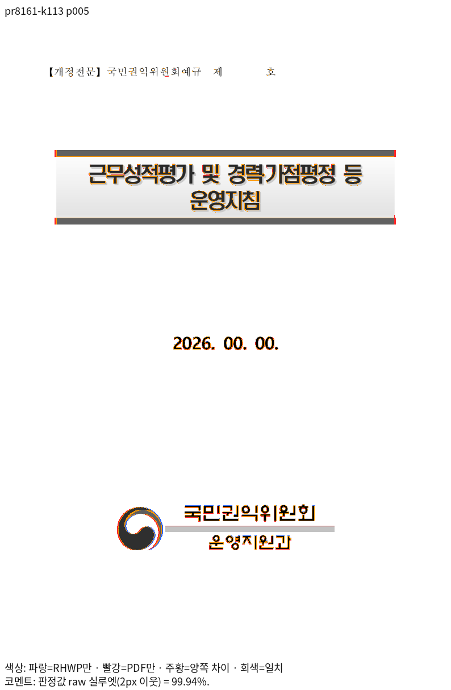

# PR #8161 리뷰 — fix(#8079): 굵은 글자 전진폭은 보통 면 값 — 저장 줄 포함

## 최종 판정

**머지 보류 — 재체리픽 후보의 검증 진행 중.** 최신 base의 기능 보존, 관련 검증과 기존 TSV 표시값의 페이지별 무하락 확인을 완료한 뒤 다시 판정한다.

## 접수와 적용

- 리베이스 후 코드 후보: `1c375f616a16166343ad0425b8e841ed999b990a`, 기준 `upstream/devel`: `2adaa0859f94f30f7dc3b994ee27c34a872906ba`. 체리픽 대응표에는 새 SHA와 리베이스 전 SHA를 함께 기록했다.
- 원 PR: [#8161](https://github.com/edwardkim/rhwp/pull/8161), 작성자 `planet6897`, reviewer `jangster77`.
- 원 PR head 조회값: `bd786fc5fefb94126ac146411f603c9cbcf336a6`. 현재 원 PR head는 기여자 마지막 커밋 뒤의 devel merge이며 merge commit은 제외했다.
- 마지막 적용 원본: `431c6a7b508305673e954b796eaff59fd295715e`. 검증 시작 당시 코드 후보: `abea5b028f8f135bdf000ca700e1993ebf0b1973`, 기준 `upstream/devel`: `bc9dfdd057258de59afebeb5121c4bee7398e07f`.
- 관련 이슈: [#8079](https://github.com/edwardkim/rhwp/issues/8079).
- 선행 PR: 별도 누적 선행 PR이 명시되지 않았다.

후속 `e1f03ffbb3`은 Python 테스트 준비, `af175315e7`과 `e920cba6b0`은 회귀 검사 주석, `a63bb719de`는 검증 경과를 기록했다. `5d1294811b`은 전체 그림의 잘림 오판을 보정했다. `e1b8ab0f54`, `d6fe30c3ad`, `0897582f6c`, `8c4eca265e`에 Native 진단, #8410 집중 6건 통과와 글꼴 대조를 기록했으며 새 코드의 전쪽 출력 검증이 필요하다.

## 2026-11-01 리베이스 후 전체 회귀

굵은 글자의 보통 면 전진폭 검사 `issue_8079_bold_regular_advance` 4건은 모두 통과했다. 최소 시스템 글꼴 환경에서 라이선스가 확인된 저장소 테스트 글꼴을 명시적으로 제공해 전체 12,349건을 실행했다. 12,347건이 통과했고 편람 261쪽 JPEG 채움 색상 HWP·HWPX 검사 2건이 실패했다. 두 실패는 오래된 JPEG 인코더 캐시를 재컴파일한 뒤 집중 검사에서 모두 통과했다 ([재검사 로그](../../../output/pr-review/planet6897-ordered-20261031/jpeg-clean-cache-focused.log)). 충돌한 PDF 세션의 HWP·HWPX 메타데이터 예산 검사는 모두 통과했다. [전체 로그](../../../output/pr-review/planet6897-ordered-20261031/rebase-full-minfont-verified-nextest.log).

재컴파일 후 전체 회귀와 최신 코드의 Native·fresh WASM 전쪽 대조가 남아 있어 최종 통과로 판정하지 않는다. 기존 1,770쪽 대조 결과는 리베이스 전 후보의 자료다.

## 원 PR 주장 페이지의 최신 Native 증거

원 PR이 제시한 `113424_evaluation_guideline.hwpx` 5쪽을 같은 한컴 2024 Print PDF와 대조했다. 해당 문서의 전체 46쪽 최저 raw는 91.51%이며, 후속 보정 대상 46쪽은 99.74%다.

[Native 전쪽 TSV](../assets/planet6897_integration_final/pr8161/native-113424.tsv) · [5쪽 review](../assets/planet6897_integration_final/pr8161/native-113424-p005-review.png) · [5쪽 overlay](../assets/planet6897_integration_final/pr8161/native-113424-p005-overlay.png) · [46쪽 review](../assets/planet6897_integration_final/pr8161/native-113424-p046-review.png) · [46쪽 overlay](../assets/planet6897_integration_final/pr8161/native-113424-p046-overlay.png)

원 PR에서 함께 제시한 다른 주장 페이지의 당시 증거는 다음과 같다. 이 자료는 원 PR 코드
`bba7229a1b`의 출력이며 현재 통합 head의 재검증 결과와 구분한다.

| 원본과 주장 페이지 | Native | 당시 fresh WASM |
| --- | --- | --- |
| `2026_oss_rst.hwp` 1쪽의 굵은 숫자와 영문 | [review](../assets/issue8079_bold_regular_advance/native-oss-p001-review.png) · [overlay](../assets/issue8079_bold_regular_advance/native-oss-p001-overlay.png) | [review](../assets/issue8079_bold_regular_advance/wasm-oss-p001-review.png) · [overlay](../assets/issue8079_bold_regular_advance/wasm-oss-p001-overlay.png) |
| `1613000-202200037-air-traffic-controller-cbta.hwp` 42쪽의 굵은 머리말 | [review](../assets/issue8079_bold_regular_advance/native-d1613-p042-review.png) · [overlay](../assets/issue8079_bold_regular_advance/native-d1613-p042-overlay.png) | [review](../assets/issue8079_bold_regular_advance/wasm-d1613-p042-review.png) · [overlay](../assets/issue8079_bold_regular_advance/wasm-d1613-p042-overlay.png) |
| `hwpx_sample2.hwp` 2쪽의 날짜와 줄 끝 | [review](../assets/issue8079_bold_regular_advance/native-hs2-p002-review.png) · [overlay](../assets/issue8079_bold_regular_advance/native-hs2-p002-overlay.png) | [review](../assets/issue8079_bold_regular_advance/wasm-hs2-p002-review.png) · [overlay](../assets/issue8079_bold_regular_advance/wasm-hs2-p002-overlay.png) |

원 PR의 입력·PDF·명령과 [쪽별 비교 TSV](../assets/issue8079_bold_regular_advance/tsv/changed-devel-vs-head.tsv)는
[원 증거 설명](../assets/issue8079_bold_regular_advance/README.md)에 기록돼 있다.

## 변경 주장과 검토 관점

굵은 TrueType의 잉크는 Bold face를 쓰고 전진폭은 같은 family의 보통 face를 사용하며 HFT는 제외한다. 저장 줄과 새 줄을 함께 다룬다.
저장 줄과 재조판의 측정·paint 소비가 독립 Print와 일치하는지 확인한다.

## 체리픽과 보정

- 원본 `df9d84afad9c965579465e9c95362f4bd0a7a67e` → 통합 `ce20cafc71b9163de08719fc3b1628d022e34b29` (이전 통합 `fe2f1d422453095a7077625a353691272bf58b8a`, 그 이전 `859a62eebb6ec03ea8a9fc0e2848d0956bb8f18a`).
- 원본 `97a95fdb89dc60dc395fd6cf9a2a6899f2729a74` → 통합 `2c61f0a7b3aa0376b209073a01db7fde696e32f0` (이전 통합 `fa15a388578323352a9735bdea7212ecd34be948`, 그 이전 `9b59df521c9c427dfb9e8ea352d2337213cc3bb3`).
- 원본 `5476c862d9d02f5795e73d52dc137099de036bf7` → 통합 `494ed857b23936853b52cc1b5ddee18970b3354a` (이전 통합 `0f3b844b66a1ba0b9209679051b186b91e86451d`, 그 이전 `d187d6762df9e77e5aba15b6558e2a540914852e`).
- 원본 `fe19ddb8729eaedc3ed8010c24d0a1cf51bd394f` → 통합 `31a9bfa47bd27c0368c6e75bca4b6b659f5bf7c9` (이전 통합 `ba452bf4fed40bfc8e56b02667eb996bc77553ce`, 그 이전 `4e084badab6e26b1bde142c1ab4bea635d08b230`).
- 원본 `32148bff81330f3a6dadcab850c14d8c9dc0f441` → 통합 `93f8a19f9d1e7b01d180e65fd7176d9d8beb6c3b` (이전 통합 `391b5c0d904c0faadca067f91dc5c81571c3016c`, 그 이전 `2dc6adff5d258785b8701ed30e84cf2749ec82ab`).
- 원본 `431c6a7b508305673e954b796eaff59fd295715e` → 통합 `07d9d61f4523524b2715090aaed34155b04d6fab` (이전 통합 `1a5c8fb0dc71a7be794dac14b314c60f52e360be`, 그 이전 `03d70548e14677ac9911f60664dfb5331bfacb11`).

`src/renderer/mod.rs`의 `LatinSlotMetrics` 복제 필드 충돌에서 새 base의 `native_otf_metrics`와 PR의 `source_font_is_hft`를 함께 보존했다.

## 검증과 증거

이전 통합 후보의 최소 글꼴 전체 회귀 로그에서 이 PR 관련 다음 모듈의 실행을 확인했다. 새 base 후보의 재실행 결과는 이 값으로 대신하지 않는다.
- [`hci_poppy_source_metric_contract.rs`](../../../tests/cases/hci_poppy_source_metric_contract.rs): 이전 실행 2건 통과, 0건 실패, 0건 건너뜀.
- [`issue_8079_bold_regular_advance.rs`](../../../tests/cases/issue_8079_bold_regular_advance.rs): 이전 실행 4건 통과, 0건 실패, 0건 건너뜀.

현재 코드에서 `issue_8079_bold_regular_advance` 4건을 최소 글꼴 환경으로 다시 실행해 모두 통과했다([집중 검사 로그](../../../output/pr-review/planet6897-ordered-20261031/font-slot-focused-minfont-after-commit.log)). 같은 실행은 #8136·#8315를 포함한 10건이며, #8161의 나머지 시각·회귀 검증 전체를 대신하지 않는다.

메인터너 보정 `6be28314c5`는 실제 원본 프로그램의 글리프 소유가 남아 있지만 글꼴 유형이 미확정인 경우, 표시 대체 글꼴의 보통 전진폭을 원본의 굵은 전진폭으로 잘못 사용하지 않도록 공통 측정 경계를 수정한다. 명시 TTF와 원본 프로그램 소유가 없는 경우의 기존 #8079 계약은 유지한다. 원본 HCI Poppy의 독립 프로그램 폭과 명시 TTF 반례를 포함한 최소 글꼴 집중 회귀 32건은 통과했다([로그](../../../output/pr-review/planet6897-ordered-20261031/source-bold-boundary-focused-minfont.log)). 이 결과는 전체 회귀 또는 Native·fresh WASM 전쪽 시각 검증을 대신하지 않는다.

검토 후보에 포함된 입력 바이트를 Git blob과 대조했다. 아래 자료는 원 PR의 제출 증거이며 새 후보의 실행 결과를 뜻하지 않는다.
- [`2026_oss_rst.hwp`](../../../samples/2026_oss_rst.hwp) — SHA-256 `b3a43578fc441d9668d06cd55c0cd267332ecb087e47ada4c5ac456af2afc78b`.
- [`2026_oss_rst.pdf`](../../../pdf/hwpx/2026_oss_rst.pdf) — SHA-256 `bec53a601cc7714a40ca340d26f971d1ab49eeb355682fc9db7b15cd5e04c86e`.
- [`1613000-202200037-air-traffic-controller-cbta.hwp`](../../../samples/issue6764/1613000-202200037-air-traffic-controller-cbta.hwp) — SHA-256 `8ef9de3f35690bf9d7994527f77cb02d4a4fcff447c219a78fbc2855d64be6e7`.

기여자가 제출한 기준 자료: [`README.md`](../../../mydocs/pr/assets/issue8079_bold_regular_advance/README.md). 해당 자료만으로 새 통합 후보의 시각 검증을 통과 처리하지 않는다.

기존 생성 목록으로 최소 글꼴 회귀 12,320건 통과·45건 건너뜀을 확인했다. 생성 목록에서 누락된 #8410 두 모듈의 6건을 목록 재작성 후 같은 환경에서 별도로 실행해 모두 통과했다. 두 실행을 구분하며 한 번의 전체 실행으로 기록하지 않는다.

2026-11-01 고정 후보의 #8389·#8397 전쪽 정밀 대조에서 2,153행 중 Native 12행, WASM 8행이 공개 기준보다 낮았다. 이 수치는 이후 GIF·Canvas 보정 전 결과이며 최종 후보의 재검증 결과가 아니다. #7905 3쪽은 GIF 오른쪽 경계 누락, sample16 35쪽 WASM은 메타파일 내부의 미대응 3픽셀이 확인됐다. #8040 두 원본은 Native·WASM 전쪽이 90% 이상이다. Native 2쪽의 정밀값은 미세하게 낮지만, 사용자 지정 표시값 기준으로는 기존과 현재 모두 100.00%여서 하락이 아니다. 진행과 근거는 [작업 기록](../../working/task_m100_planet6897_system_fonts_20261031.md)을 따른다. 하락 보정과 전쪽 대조, 각 PR의 독립 Print·Native/fresh WASM 및 직접 판독을 완료해야 한다. #8410·#8412의 새 base 기능도 별도로 보존 검증한다.

원 PR의 최신 head·required check와 통합 후보의 새 검증 결과를 확인하기 전에는 승인이나 merge를 진행하지 않는다.

이전 통합 후보 `6be28314c5`에서 굵은 맑은 고딕 폭의 OSS HWP·HWPX와 원본 HFT 폭 반례
`issue5169` HWP를 같은 독립 Print와 Native·fresh WASM 전쪽 대조했다. 세 입력은
각 6쪽이며 전쪽 최저는 Native 99.92% 이상, WASM 99.99% 이상이다. 고정 좌표를
확인하는 1쪽의 글줄·숫자 간격과 HFT 굵은 제목도 직접 판독했다.
[입력·PDF 해시, 전체 TSV와 해당 쪽 review·overlay](../assets/issue8079_bold_regular_advance/integration-planet6897/README.md)에
연결했다. 이 자료는 이 PR의 해당 주장에 관한 증거이며 통합 전체의 무하락 검증을
대신하지 않는다.

2026-11-01 이전 통합 후보 `6be28314c5`에서 원 PR의 대조 입력
`samples/issue6551/113424_evaluation_guideline.hwpx`와 한컴 2024 Print 46쪽을
전쪽 대조했다. 26·28·46쪽은 Native 각각 77.16%·70.70%·75.14%, WASM 각각
77.13%·70.52%·75.06%로 재검토 대상이다. 이는 이후 수정의 검증 결과가 아니다.
28쪽에서는 저장 제목 줄의 `vertical_pos=500`, 다음 본문 줄의 `vertical_pos=6081`이고,
현재 본문 원점은 500 HWP 단위만큼 위로 당겨진 값과 일치한다. 제목과 본문은
독립 Print에서 해당 간격이 유지되는지도 직접 확인했다. 단 상단 저장 원점의 측정·배치
소비 경로와 정상 대조군을 분석 중이며, 원인과 수정의 타당성은 재검증 전 확정하지 않는다.
같은 후보의 쪽 덤프에서 제목 문단의 예약 높이는 앞 간격 6.67px을 포함한
74.41px이고 실제 후속 본문은 저장 원점보다 6.67px 위다. 측정값이 실제 배치의
최종 원점까지 전달되는지 확인해야 한다. 26·46쪽도 미달하지만 같은 원인이라고
가정하지 않고 각각 판독한다.
26쪽은 첫 표 아래 문단과 뒤의 제목 사이에서 오차가 다시 사라진다. 46쪽의 마지막
표는 행 높이의 누적 오차보다 표 전체 원점이 늦은 차이다. PDF 수평선과 렌더 트리를
대조하면 첫 행 773.39px 대 780.9px, 마지막 행 974.29px 대 982.0px이다. 두 쪽은
표와 후속 문단의 저장 좌표 소유 경로를 따로 확인한다.
26쪽 원본에서는 앞 문단의 저장 끝 `1000+1500+1200=3700`, 표의 위 여백·본체·
아래 여백을 더한 끝 `3700+283+10312+283=14578`이 공백 호스트 줄의 저장 원점과
일치한다. 이 줄의 `1500-752`와 다음 문단의 앞 간격 `300`을 더하면 다음 저장 원점
`15626`이 된다. 기존 공통 프레임 판정은 음수 줄간격을 제외하고 있어 이 저장 경계를
수용하는지 확인해야 한다. 46쪽은 글이 있는 호스트의 표 상자 끝
`13920+2334+140+28437+140=44971`이 후속 첫 줄 원점과 같다. 현재 페인트 커서도
이 위치에 도달한 뒤 후속 앞 간격을 한 번 더 적용하므로 측정과 배치의 간격 소유를
대조한다. 이 두 등식만으로 다른 저장 생성기 전체에 일반화하지 않는다.
HWPX의 문단 속성에는 문자 단위와 기본 분기의 값이 함께 있으므로 앞 간격은 원본 XML의
숫자를 임의로 선택하지 않고 실제 조판에 쓰인 `ResolvedStyleSet` 값으로 대조해야 한다.
26쪽은 파서 덤프의 앞 간격 600HU와 조판된 300HU가 서로 다른 표현이다.
해당 저장 프레임 공통 판정의 선행 통합은 #8191(`6097253468`)이다. 수정 시 이 PR의
기존 빈 호스트와 실제 글줄이 표 위에 있는 호스트를 구분해 측정·배치가 같은 결과를
사용하는지 확인하고, 양쪽의 닫히지 않는 저장 경계도 반례로 검증한다.
단 상단에 보존된 프레임을 도형 높이 전진에도 사용한 중간 Native 후보에서 28쪽은
70.70%에서 94.94%로 개선됐다. 7·8쪽 대조군은 각각 99.71%·98.01%다. 28쪽 본문
위치는 맞아졌으나 대체 글꼴로 그린 제목의 폭 차이는 남았다. 이 수치는 26·46쪽의
후속 수정과 fresh WASM 검증을 포함하지 않는다.
제목의 `휴먼엑스포`는 한컴 Print에서 두꺼운 면이지만 해당 글꼴이 없는 환경에서는
대체 글꼴이 가늘게 표시되는 차이도 발견했다. 글꼴 프로그램 설치에 의존하지 않는
대체 처리와 실제 글꼴이 존재하는 반례를 함께 확인한다.
`win10-ted`의 `C:\Windows\Fonts\HMFMMUEX.TTC`에서 `Expo M` / `휴먼엑스포`
face를 확인했다. 독립 Print의 내장 이름 `ExpoM-HM`과 일치하며, 사용자 지시에 따라
로컬 검증에만 사용한다. 시스템 폰트에 원본이 없는 결과와 원본을 명시한 결과는 분리한다.
원본을 명시한 중간 Native 출력은 5쪽 99.94%, 28쪽 95.06%였으나 28쪽 제목 폭은
여전히 다르다. TTC 두 번째 face의 `0`·`2` 전진은 각각 442/512·325/512em이며
한컴 PDF의 해당 문자 원점 차이와 일치한다. 현재 실제 프로그램 폭 준비가 HFT 슬롯에만
적용돼 원본 TrueType의 반각 추정 폭을 대체하지 못하는 경로를 수정해야 한다.

후속 원인 대조에서는 시스템의 같은 TTC가 대표 이름 `Expo M`과 한글 family
`휴먼엑스포`를 함께 선언함을 확인했다. 기존 Native 실행에서 후자를 전자로 명시해
실제 설치 face를 사용하면 28쪽 raw는 95.06%에서 100.00%가 되고 제목도 Print와
일치한다. 이는 이름 조회 경로의 반례이며 최종 수정 결과는 아니다. Linux에서 사용자
글꼴 설치 위치가 현지화 이름 복구 검색에서 빠진 경로를 수정하고, 별칭 지정 없이
다시 측정해야 한다.

별칭 없이 재측정한 결과는 여전히 95.06%였다. 디버거로 실제
`register_otf_for_source` 반환값을 확인한 결과 `휴먼엑스포` 등록은 64MiB 보유 한도에
걸려 거절됐다. 다른 글꼴을 제한하고 동일 TTC만 명시적으로 공급하면 제목의 모양과
전진폭이 Print와 맞는다. 따라서 디렉터리 보정만으로 완결됐다고 판정하지 않는다.
일반 TrueType은 세션에 문자 매핑·전진폭 표만 보존하도록 수정하고, 가변 글꼴과 CFF는
기존 경로를 유지하는 보정의 회귀·시각 검증을 진행한다.

보정 후보를 전체 시스템 글꼴 환경에서 다시 출력한 Native 28쪽은 raw 100.00%,
46쪽은 99.74%다. 28쪽 제목은 독립 Print와 직접 대조했다.
[28쪽 review](../assets/planet6897_integration_final/pr8161/native-113424-p028-review.png) ·
[28쪽 overlay](../assets/planet6897_integration_final/pr8161/native-113424-p028-overlay.png).
이는 선택 쪽의 결과이며 전쪽과 fresh WASM 최종 검증을 대신하지 않는다.
저장소 시험 TTF와 TTC 3개 face의 전 유니코드 문자 매핑·전진폭 보존, 64MiB 제한
경계 및 기존 공백 글꼴 계약은 최소 글꼴 환경에서 3건 모두 통과했다.
