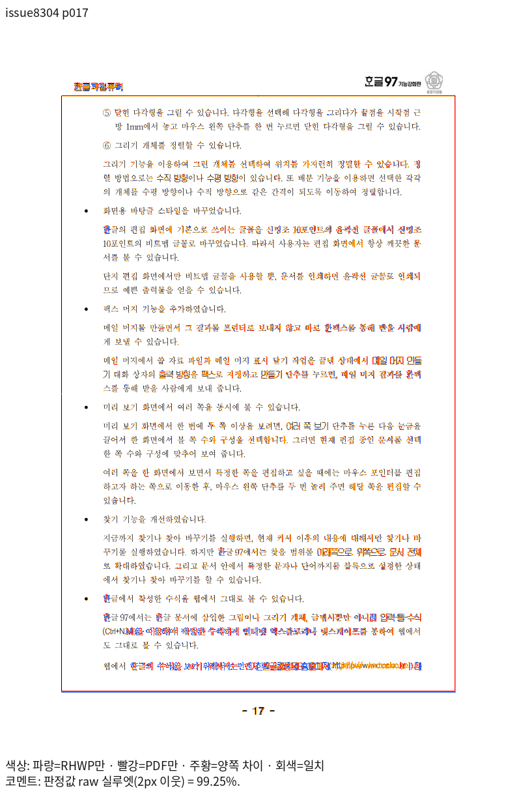

# PR #8346 리뷰 — fix(parser/hwp3): 찾아보기 표시를 공통 IR로 읽고, 암호 HWP3 문서의 쪽 배경·문단 간격·표 간격·하이퍼텍스트 상자를 한컴 변환본과 맞춘다 (#8304)

## 최종 판정

**머지 보류 — 재체리픽 후보의 검증 진행 중.** 최신 base의 기능 보존, 관련 검증과 기존 TSV 표시값의 페이지별 무하락 확인을 완료한 뒤 다시 판정한다.

## 접수와 적용

- 리베이스 후 코드 후보: `1c375f616a16166343ad0425b8e841ed999b990a`, 기준 `upstream/devel`: `2adaa0859f94f30f7dc3b994ee27c34a872906ba`. 체리픽 대응표에는 새 SHA와 리베이스 전 SHA를 함께 기록했다.
- 원 PR: [#8346](https://github.com/edwardkim/rhwp/pull/8346), 작성자 `planet6897`, reviewer `jangster77`.
- 원 PR head 조회값: `923ae70036a6b6e5ce94bf9c45cd2f8326cf8551`. 현재 원 PR head는 기여자 마지막 커밋 뒤의 devel merge이며 merge commit은 제외했다.
- 마지막 적용 원본: `75f167cee39b69f10d1eff25e5f9f55b18e64783`. 검증 시작 당시 코드 후보: `abea5b028f8f135bdf000ca700e1993ebf0b1973`, 기준 `upstream/devel`: `bc9dfdd057258de59afebeb5121c4bee7398e07f`.
- 관련 이슈: [#8304](https://github.com/edwardkim/rhwp/issues/8304).
- 선행 PR: 별도 누적 선행 PR이 명시되지 않았다.

후속 `e1f03ffbb3`은 Python 테스트 준비, `af175315e7`과 `e920cba6b0`은 회귀 검사 주석, `a63bb719de`는 검증 경과를 기록했다. `5d1294811b`은 전체 그림의 잘림 오판을 보정했다. `e1b8ab0f54`, `d6fe30c3ad`, `0897582f6c`, `8c4eca265e`에 Native 진단, #8410 집중 6건 통과와 글꼴 대조를 기록했으며 새 코드의 전쪽 출력 검증이 필요하다.

## 2026-11-01 리베이스 후 전체 회귀

HWP3 찾아보기·개요 번호 검사 `issue_8304_hwp3_index_mark` 9건은 모두 통과했다. 최소 시스템 글꼴 환경에서 라이선스가 확인된 저장소 테스트 글꼴을 명시적으로 제공해 전체 12,349건을 실행했다. 12,347건이 통과했고 편람 261쪽 JPEG 채움 색상 HWP·HWPX 검사 2건이 실패했다. 두 실패는 오래된 JPEG 인코더 캐시를 재컴파일한 뒤 집중 검사에서 모두 통과했다 ([재검사 로그](../../../output/pr-review/planet6897-ordered-20261031/jpeg-clean-cache-focused.log)). 충돌한 PDF 세션의 HWP·HWPX 메타데이터 예산 검사는 모두 통과했다. [전체 로그](../../../output/pr-review/planet6897-ordered-20261031/rebase-full-minfont-verified-nextest.log).

제품 코드 커밋 `d536455b4e`에서 최소 글꼴 환경의 전체 회귀 12,368건은 모두 통과했다. 이후 변경은 테스트 이동과 서식 정리이며 이동한 검사만 재실행한다. #8389·#8397 기준 1,770쪽의 Native·fresh WASM 전쪽 비교가 진행 중이므로 아직 최종 통과로 판정하지 않는다.

## 원 PR 주장 페이지의 최신 Native·fresh WASM 증거

암호 HWP3 원본 `samples/HWP3-password-123456.hwp`을 동일 원본의 한컴 2020 Print와 대조했다. 전 24쪽 최저 raw는 Native 98.27%, fresh WASM 98.28%다. 원 PR이 명시한 찾아보기·하이퍼텍스트 상자와 본문 위치를 각각 3·17·20·24쪽에서 대조했다.

[Native 전쪽 TSV](../assets/planet6897_integration_final/pr8346/native-hwp3-original.tsv) · [fresh WASM 전쪽 TSV](../assets/planet6897_integration_final/pr8346/wasm-hwp3-original.tsv) · [3쪽 review](../assets/planet6897_integration_final/pr8346/native-hwp3-p003-review.png) · [17쪽 review](../assets/planet6897_integration_final/pr8346/native-hwp3-p017-review.png) · [17쪽 overlay](../assets/planet6897_integration_final/pr8346/native-hwp3-p017-overlay.png) · [20쪽 review](../assets/planet6897_integration_final/pr8346/native-hwp3-p020-review.png) · [24쪽 review](../assets/planet6897_integration_final/pr8346/native-hwp3-p024-review.png)

같은 17쪽의 fresh WASM [review](../assets/planet6897_integration_final/pr8346/wasm-hwp3-p017-review.png) · [overlay](../assets/planet6897_integration_final/pr8346/wasm-hwp3-p017-overlay.png)도 확인했다. 첫 쪽 배경과 2쪽 이후 배경 제거, 3·7·20·24쪽의 표·본문·상자에 해당하는 두 경로의 이미지는 같은 증거 폴더에 있다.

원 PR의 첫 쪽 배경과 후속 쪽 배경 제거 주장은 [1쪽 review](../assets/planet6897_integration_final/pr8346/native-hwp3-p001-review.png) · [1쪽 overlay](../assets/planet6897_integration_final/pr8346/native-hwp3-p001-overlay.png), [2쪽 review](../assets/planet6897_integration_final/pr8346/native-hwp3-p002-review.png) · [2쪽 overlay](../assets/planet6897_integration_final/pr8346/native-hwp3-p002-overlay.png)로 확인한다. 문단 간격 대조에는 [7쪽 review](../assets/planet6897_integration_final/pr8346/native-hwp3-p007-review.png) · [7쪽 overlay](../assets/planet6897_integration_final/pr8346/native-hwp3-p007-overlay.png)를 연결했다.

## 변경 주장과 검토 관점

HWP3 찾아보기 표시를 읽고 암호 문서의 배경·간격·표·하이퍼텍스트 처리를 보정한다.
사용자가 검토 범위에서 제외한 sample16 및 편람을 복원하지 않고 적용 대상만 확인한다.

## 체리픽과 보정

- 원본 `e33936a264f866cd8e7e43890962eb10eb67c5a6` → 통합 `af3f5d82d6c43a8e0b6f7ba7cc45940533510752` (이전 통합 `b9affc985f058cb677b0be6d0899df531f1e633c`, 그 이전 `e2222e48890db0fd4dd3b4957aca3be507996752`).
- 원본 `42b992cd1288db2c3fa3bc8dbf007a1524805cdc` → 통합 `3060cc2c6c168563123c8faed799093187345150` (이전 통합 `d4807c6a9a801ffeb78a3b1a7ff0fba6b5c8e5ee`, 그 이전 `39656f5b783a297ffe83d02d4af43f15f02bd1ae`).
- 원본 `75f167cee39b69f10d1eff25e5f9f55b18e64783` → 통합 `698c906a2bd5bd8ad1ca38cc3a38d36aa6e539cf` (이전 통합 `dc59b5e5bc40bbc3948d3e0c96c54afe0e4ac58f`, 그 이전 `b5aa0c7e9489190a7cea82783e45f895f9628bca`).

`src/parser/hwp3/mod.rs` 충돌은 이전 보정 당시와 양쪽 Git blob이 동일해 기존 해결본을 재사용했다.

이번 검토 범위에서 제외한 sample16을 직접 열던 빈 하이퍼텍스트 대조 함수는 제거했다. 암호 HWP3 원본을 사용하는 찾아보기·쪽 배경·본문 검사들은 유지한다. 제거한 함수가 보호하던 빈 상자 반례는 이 PR의 독립 회귀 근거로 주장하지 않는다.

## 검증과 증거

이전 통합 후보의 최소 글꼴 전체 회귀 로그에서 이 PR 관련 다음 모듈의 실행을 확인했다. 새 base 후보의 재실행 결과는 이 값으로 대신하지 않는다.
- [`issue_8304_hwp3_index_mark.rs`](../../../tests/cases/issue_8304_hwp3_index_mark.rs): 이전 실행 7건 통과, 0건 실패, 0건 건너뜀.

검토 후보에 포함된 입력 바이트를 Git blob과 대조했다. 아래 자료는 원 PR의 제출 증거이며 새 후보의 실행 결과를 뜻하지 않는다.
- [`HWP3-password-123456.hwp`](../../../samples/HWP3-password-123456.hwp) — SHA-256 `db743d084efc9e08e839a5b4d978b16b8676434011776e090e4cda43e57304be`.
- [`HWP5-nopassword-123456.hwp`](../../../samples/HWP5-nopassword-123456.hwp) — SHA-256 `a34ecb8cde85b6db49c64a954cb7fa5d23b5f49367bc4753c90bfe89a075b50d`.
- [`HWP3-password-123456.pdf`](../../../pdf/HWP3-password-123456.pdf) — SHA-256 `3ced5ad95ad30331e2756b5b34509c1ac91dfe3c72013c8e14f2556ca6bd5776`.

기여자가 제출한 기준 자료: [`h3_hwp5_base_silhouette.tsv`](../../../mydocs/pr/assets/issue_8304/native/h3_hwp5_base_silhouette.tsv). 해당 자료만으로 새 통합 후보의 시각 검증을 통과 처리하지 않는다.

2026-11-01 Native 중간 후보 SHA-256 `a53264efa0f40b8c851f2e6825e984fc9d5666cd9a23e79ad708c2ed1fb71b7a`에서 암호 HWP3 **원본**을 열어 한컴 Print PDF와 전 24쪽을 96 DPI로 대조했다. 시험 fixture 암호는 검토용 래퍼가 표준 입력으로 전달했다. 전쪽 최저 raw는 3쪽 `94.82%`다. [임시 TSV](../../../output/pr-review/planet6897-ordered-20261031/issue8304-current-native-first/issue8304-original/silhouette.tsv), [3쪽 review](../../../output/pr-review/planet6897-ordered-20261031/issue8304-current-p003-review/issue8304-p003/review/review_003.png), [overlay](../../../output/pr-review/planet6897-ordered-20261031/issue8304-current-p003-review/issue8304-p003/overlay/overlay_003.png)를 남겼다. 이후 글꼴 출처 코드가 변경돼 새 후보와 fresh WASM을 다시 확인해야 하며, 이 결과를 최종 검증으로 사용하지 않는다.

3쪽 확대 판독에서는 하단 폴더 설명의 글자 위치와 간격 차이가 눈에 띈다. 90% 통과만으로 해당 영역을 완료로 판정하지 않으며, 같은 입력의 기준 코드·새 후보·독립 Print를 대조해 원인을 확인한다.

같은 시스템 글꼴과 PDF를 사용한 #8397 기준 코드 `99a176b7cb`의 3쪽 raw는 `40.94944%`였다. 위 중간 후보는 `94.82%`로 개선됐지만 잔여 차이의 해결이나 이후 후보의 결과를 뜻하지 않는다. 기준 측정은 결과 산출 후 90% 게이트에서 종료 코드 1을 반환했다([기준 로그](../../../output/pr-review/planet6897-ordered-20261031/issue8304-base-p003.log)).

후속 Native 후보 `b38728ae6740b44deb2a6b5c574110d07c5b44535db34b593284a45276b2a3c7`에서도 같은 암호 원본을 전 24쪽 재출력했다. 각 쪽 PNG SHA-256은 직전 후보와 모두 같고 최저 raw는 3쪽 `94.82%`다([임시 TSV](../../../output/pr-review/planet6897-ordered-20261031/issue8304-hwp5-face-source-native/issue8304-original/silhouette.tsv)). 위 3쪽 이미지는 같은 출력에 재사용할 수 있으나, fresh WASM과 하단 간격의 검토는 남아 있다.

기존 생성 목록으로 최소 글꼴 회귀 12,320건 통과·45건 건너뜀을 확인했다. 생성 목록에서 누락된 #8410 두 모듈의 6건을 목록 재작성 후 같은 환경에서 별도로 실행해 모두 통과했다. 두 실행을 구분하며 한 번의 전체 실행으로 기록하지 않는다.

제외 입력 정리 후 최소 글꼴 환경에서 #8304의 남은 6개 검사가 모두 통과했다. #8303의 3개 검사와 한 번에 실행한 [집중 검사 로그](../../../output/pr-review/planet6897-ordered-20261031/excluded-fixture-focused-minfont.log)에서 두 모듈 합계 9건 통과를 확인했다. 전체 검사의 대체 결과는 아니다.

2026-11-01 고정 후보의 #8389·#8397 전쪽 정밀 대조에서 2,153행 중 Native 12행, WASM 8행이 공개 기준보다 낮았다. 이 수치는 이후 GIF·Canvas 보정 전 결과이며 최종 후보의 재검증 결과가 아니다. #7905 3쪽은 GIF 오른쪽 경계 누락, sample16 35쪽 WASM은 메타파일 내부의 미대응 3픽셀이 확인됐다. #8040 두 원본은 Native·WASM 전쪽이 90% 이상이다. Native 2쪽의 정밀값은 미세하게 낮지만, 사용자 지정 표시값 기준으로는 기존과 현재 모두 100.00%여서 하락이 아니다. 진행과 근거는 [작업 기록](../../working/task_m100_planet6897_system_fonts_20261031.md)을 따른다. 하락 보정과 전쪽 대조, 각 PR의 독립 Print·Native/fresh WASM 및 직접 판독을 완료해야 한다. #8410·#8412의 새 base 기능도 별도로 보존 검증한다.

원 PR의 최신 head·required check와 통합 후보의 새 검증 결과를 확인하기 전에는 승인이나 merge를 진행하지 않는다.

### 2026-11-01 독립 Print 재확인

암호 HWP3 원본을 한컴 2020 MCP에서 내용 변경 없이 인쇄했다. 작업 ID는
`c3326c00-7816-49be-bf03-f0e616eeabb4`, 한컴 버전은 `11.0.0.9136`,
출력 경로는 `PrintMethod=0`이며 원본과 PDF는 각각 24쪽이다. 새 기준
[`HWP3-password-123456-print-2020.pdf`](../../../pdf/issue8304/HWP3-password-123456-print-2020.pdf)의
SHA-256은 `279effba40fd2fe3bff6682cd6ee272cc9f49ca3fb1616f929871672637a8348`이다.

같은 후보의 96 DPI 출력과 새 PDF를 전쪽 대조한 최저 raw는 Native **94.73%**,
fresh WASM **93.84%**다. [Native TSV](../../../output/pr-review/planet6897-ordered-20261031/issue8304-mcp-pair-native/silhouette.tsv)와
[WASM TSV](../../../output/pr-review/planet6897-ordered-20261031/issue8304-mcp-pair-wasm/silhouette.tsv)를 확인했다.
WASM은 공개 fixture의 암호를 `HwpDocument.openWithPassword`로 넘기는 전용 출력 래퍼
`issue8304-wasm-password-exporter.mjs`(SHA-256 `cbbd54c7f55975bd7d282c32ec09cc14ffb3b3161e63e615889c58c966f8abbe`)를 사용했다.
기본 Visual Sweep 출력기가 암호 인자를 지원한 것으로 간주하지 않는다.

[3쪽 review](../../../output/pr-review/planet6897-ordered-20261031/issue8304-mcp-review-native/issue8304-original/review/review_003.png)와
[overlay](../../../output/pr-review/planet6897-ordered-20261031/issue8304-mcp-review-native/issue8304-original/overlay/overlay_003.png)에서
하단 폴더 이름 뒤 설명의 첫 줄 시작점이 기준과 다르다. 이전 #1950의 #1991 수정은
HWP3 탭의 저장 문자 오프셋을 HWP5 직렬화와 통일한 것으로 원본 HWP3 렌더 변경은 아니다.
현재 차이의 원인을 그 수정으로 단정하지 않으며, 탭 저장 폭과 줄 프레임의 측정·배치 소비를
추적 중이다. 90% 이상이라는 수치만으로 이 영역을 완료 판정하지 않는다.

비암호 HWP5 대조 원본과 한컴 2024 Print PDF의 전 24쪽 최저 raw는 Native **94.32%**,
fresh WASM **98.22%**다([Native 로그](../../../output/pr-review/planet6897-ordered-20261031/issue8304-hwp5-current-native.log),
[WASM 로그](../../../output/pr-review/planet6897-ordered-20261031/issue8304-hwp5-current-wasm.log)).
이는 HWP3 하단 탭 차이가 해결됐다는 근거가 아니다.

추가 원인 진단에서 3쪽 `\HNC\USER`의 HWP3 원본은 `견명조`를 사용하고
한컴 저장 HWP5 대응본은 `한양견명조`를 사용한다. 두 글자 모양의 크기·장평·자간은 같지만,
글꼴 프로그램을 공급하지 않은 동일 WASM 진단에서 첫째의 ASCII 전진은 글자마다 7.5px이고
둘째는 글자별로 다르며 전체 폭은 각각 67.2px과 92.2px이다. 시스템에는 두 이름에 대응하는
별도 OTF가 등록돼 있다. 원본을 변경하지 않고 진단 환경에서 `견명조`를 `한양견명조`로
대체했을 때 Native 3쪽 raw는 **94.73% → 99.91%**였으며 하단 설명의 시작점도 기준에
가까워졌다([review](../../../output/pr-review/planet6897-ordered-20261031/issue8304-font-diagnostic/issue8304-font-diagnostic/review/review_003.png),
[overlay](../../../output/pr-review/planet6897-ordered-20261031/issue8304-font-diagnostic/issue8304-font-diagnostic/overlay/overlay_003.png)).
이것은 원인 분리를 위한 임시 설정이며 제품의 자동 글꼴 선택이나 전쪽 무회귀 검증 결과가 아니다.
HWP3의 기존 ASCII 반각 계약과 실제 선택된 글꼴 프로그램의 경계를 함께 확인한 후 공통 경로의
수정 여부를 결정한다.

### 사용자 정의 개요 번호 보정

19·20·23쪽을 확대해 보니 독립 Print와 한컴 저장 HWP5는 제목 번호가 각각 `가.`, `나.`,
`사.`인데, 수정 전 HWP3 원본 출력은 `I.`, `II.`, `VII.`였다. 수정 전 고정 바이너리의
[출력 대조](../../../output/pr-review/planet6897-ordered-20261031/issue8304-outline-red-baseline.log)와
[19쪽 review](../../../output/pr-review/planet6897-ordered-20261031/issue8304-font-drops-review/issue8304-font-drops/review/review_019.png)·
[overlay](../../../output/pr-review/planet6897-ordered-20261031/issue8304-font-drops-review/issue8304-font-drops/overlay/overlay_019.png)를 확인했다.

한글 3.0 사양 §10.21 표 62의 개요 제어는 사용자 정의 번호 형식 일곱 개와 앞뒤 장식을
저장한다. 비밀번호 원본을 복호화한 바이트에서는 해당 제목들의 형식이 `5`, 장식이 `.`이고
번호가 1부터 7까지다. 한컴이 저장한 HWP5 대응 번호 형식은 `HANGUL_SYLLABLE`이다.
기존 파서는 형식·장식을 버리고 모든 제목에 기본 로마 숫자 정의를 할당했다. 이 경로의
선행 해결 [#3502](https://github.com/edwardkim/rhwp/pull/3502)의 #3492 보정은 임시 개요 마커를 IR에서 제거해 저장 손실을 막은 것으로, 형식 배열을
복원했다는 근거는 아니다.

사용자 정의 형식·장식을 임시 마커에서 공통 `Numbering`으로 옮기고 기존처럼 마커는
제거한다. 독립 출력으로 확인한 한글 음절 형식만 활성 사용 단계에 적용하며, 다른 형식이
섞이거나 해석할 수 없는 장식이 있으면 기존 경로를 유지한다. 공통 번호 정의를 재사용해
번호의 순서를 보존한다. 글꼴 대체 진단은 이 파서 수정과 별도다.

첫 최소 글꼴 집중 실행은 **7건 통과**했다([로그](../../../output/pr-review/planet6897-ordered-20261031/issue8304-outline-focused-minfont.log)).
그 빌드 중 적용 경계와 HWP5/HWPX 저장 후 재열기 검사를 보완했으므로 첫 결과를 최신 소스의
통과로 사용하지 않는다. 최신 집중 검사와 Native/fresh WASM 출력, 전체 기능 보존 대조가
완료되기 전까지 최종 판정은 보류한다.

추가로 기존 `hwp3_font_name_to_hwp5` 공통 정규화에서 `견명조`가 누락된 것을 확인했다.
원본 HWP3의 한글·영문 슬롯과 한컴 2024 저장 HWP5를 비교하면 모두 `견명조`가
`한양견명조` HFT로 대응한다. 한컴 2020 Print의 폴더명·후속 본문 위치도 이를 뒷받침한다.
다른 HWP3 글꼴과 같은 공통 경로로 이 이름을 정규화하고 `alt_name`에는 원래 이름을
보존하도록 수정했다. 원본과 한컴 저장본의 글꼴 이름·유형 및 3쪽 첫 설명 줄과 이어지는
줄의 시작선 관계를 확인하는 글꼴 비의존 회귀를 추가했다. 설정을 강제했던 앞의 진단 수치는
실제 코드 수정 후 결과가 아니므로 별도로 새 Native와 fresh WASM을 실행한다.
