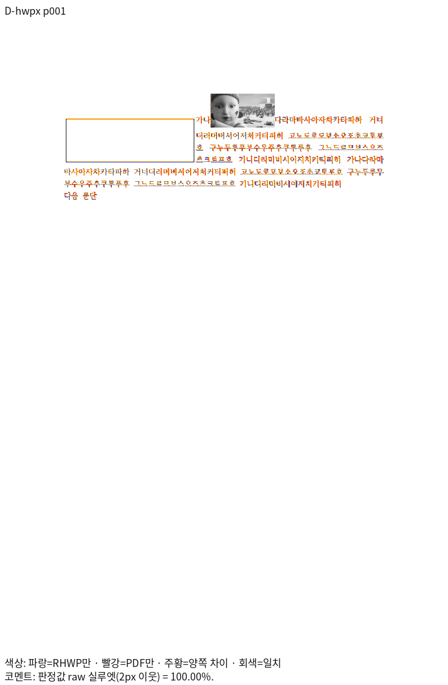

# PR #8405 리뷰 — fix(layout): 어울림 글상자 바깥 상자로 본문 줄을 깎는다 (#8399)

## 최종 판정

**메인터너 보정 후 수용 가능 — 로컬 검증 완료.** 원 PR은 통합 후보에 순서대로 적용했으며 제품 코드 `d536455b4e`의 최소 글꼴 전체 회귀 12,368건과 Native Skia 필수 검사를 통과했다. #8389·#8397의 기존 기준 2,153행은 Native와 fresh WASM 모두 표시값 하락이 없다. [Native 대조표](../assets/planet6897_integration_final/pr8389_8397/native-display-comparison.tsv) · [WASM 대조표](../assets/planet6897_integration_final/pr8389_8397/wasm-display-comparison.tsv). 통합 PR의 최종 head CI와 merge 가능 상태는 게시 후 별도로 확인한다.

## 접수와 적용

- 리베이스 후 코드 후보: `1c375f616a16166343ad0425b8e841ed999b990a`, 기준 `upstream/devel`: `2adaa0859f94f30f7dc3b994ee27c34a872906ba`. 체리픽 대응표에는 새 SHA와 리베이스 전 SHA를 함께 기록했다.
- 원 PR: [#8405](https://github.com/edwardkim/rhwp/pull/8405), 작성자 `planet6897`, reviewer `jangster77`.
- 원 PR head 조회값: `df932ebcf6144b468bebab8f5a2f2d2379807a8a`. 조회 시 원 PR head와 마지막 체리픽 원본이 일치한다.
- 마지막 적용 원본: `df932ebcf6144b468bebab8f5a2f2d2379807a8a`. 검증 시작 당시 코드 후보: `abea5b028f8f135bdf000ca700e1993ebf0b1973`, 기준 `upstream/devel`: `bc9dfdd057258de59afebeb5121c4bee7398e07f`.
- 관련 이슈: [#8399](https://github.com/edwardkim/rhwp/issues/8399).
- 선행 PR: #8402.

후속 `e1f03ffbb3`은 Python 테스트 준비, `af175315e7`과 `e920cba6b0`은 회귀 검사 주석, `a63bb719de`는 검증 경과를 기록했다. `5d1294811b`은 전체 그림의 잘림 오판을 보정했다. `e1b8ab0f54`, `d6fe30c3ad`, `0897582f6c`, `8c4eca265e`에 Native 진단, #8410 집중 6건 통과와 글꼴 대조를 기록했으며 새 코드의 전쪽 출력 검증이 필요하다.

## 2026-11-01 리베이스 후 전체 회귀

어울림 그림·글상자 관련 `issue_8282` 11건과 `issue_8399` 8건은 모두 통과했다. 최소 시스템 글꼴 환경에서 라이선스가 확인된 저장소 테스트 글꼴을 명시적으로 제공해 전체 12,349건을 실행했다. 12,347건이 통과했고 편람 261쪽 JPEG 채움 색상 HWP·HWPX 검사 2건이 실패했다. 두 실패는 오래된 JPEG 인코더 캐시를 재컴파일한 뒤 집중 검사에서 모두 통과했다 ([재검사 로그](../../../output/pr-review/planet6897-ordered-20261031/jpeg-clean-cache-focused.log)). 충돌한 PDF 세션의 HWP·HWPX 메타데이터 예산 검사는 모두 통과했다. [전체 로그](../../../output/pr-review/planet6897-ordered-20261031/rebase-full-minfont-verified-nextest.log).

제품 코드 커밋 `d536455b4e`에서 최소 글꼴 환경의 전체 회귀 12,368건은 모두 통과했다. 이후 변경은 테스트 이동과 서식 정리이며 이동한 검사만 재실행한다. #8389·#8397 기준 1,770쪽, 원 기준 TSV 2,153행의 Native·fresh WASM 전쪽 대조에서 표시값 하락은 없었다.

## 원 PR 주장 페이지의 최신 Native·fresh WASM 증거

원 PR이 제시한 A·D·E·P의 HWP/HWPX와 각각의 독립 한컴 2024 Print를 대조했다. 각 입력은 1쪽이며 두 경로의 raw는 A·D·E 100.00%, P 99.98%다. D의 줄 배제와 글상자 위치, A의 후속 문단 관계를 원 PR과 같은 입력에서 확인했다.

[Native A HWP TSV](../assets/planet6897_integration_final/pr8405/native-A-hwp.tsv) · [Native D HWPX TSV](../assets/planet6897_integration_final/pr8405/native-D-hwpx.tsv) · [Native P HWPX TSV](../assets/planet6897_integration_final/pr8405/native-P-hwpx.tsv) · [D review](../assets/planet6897_integration_final/pr8405/native-D-hwpx-review.png) · [D overlay](../assets/planet6897_integration_final/pr8405/native-D-hwpx-overlay.png) · [A review](../assets/planet6897_integration_final/pr8405/native-A-hwp-review.png) · [A overlay](../assets/planet6897_integration_final/pr8405/native-A-hwp-overlay.png)

[fresh WASM A HWP TSV](../assets/planet6897_integration_final/pr8405/wasm-A-hwp.tsv) · [fresh WASM D HWPX TSV](../assets/planet6897_integration_final/pr8405/wasm-D-hwpx.tsv) · [fresh WASM P HWPX TSV](../assets/planet6897_integration_final/pr8405/wasm-P-hwpx.tsv). 나머지 A·D·E·P HWP/HWPX TSV도 같은 폴더에 입력별로 보존했다.

| 원본 | Native 전체 TSV | fresh WASM 전체 TSV |
| --- | --- | --- |
| A HWP | [Native](../assets/planet6897_integration_final/pr8405/native-A-hwp.tsv) | [WASM](../assets/planet6897_integration_final/pr8405/wasm-A-hwp.tsv) |
| A HWPX | [Native](../assets/planet6897_integration_final/pr8405/native-A-hwpx.tsv) | [WASM](../assets/planet6897_integration_final/pr8405/wasm-A-hwpx.tsv) |
| D HWP | [Native](../assets/planet6897_integration_final/pr8405/native-D-hwp.tsv) | [WASM](../assets/planet6897_integration_final/pr8405/wasm-D-hwp.tsv) |
| D HWPX | [Native](../assets/planet6897_integration_final/pr8405/native-D-hwpx.tsv) | [WASM](../assets/planet6897_integration_final/pr8405/wasm-D-hwpx.tsv) |
| E HWP | [Native](../assets/planet6897_integration_final/pr8405/native-E-hwp.tsv) | [WASM](../assets/planet6897_integration_final/pr8405/wasm-E-hwp.tsv) |
| E HWPX | [Native](../assets/planet6897_integration_final/pr8405/native-E-hwpx.tsv) | [WASM](../assets/planet6897_integration_final/pr8405/wasm-E-hwpx.tsv) |
| P HWP | [Native](../assets/planet6897_integration_final/pr8405/native-P-hwp.tsv) | [WASM](../assets/planet6897_integration_final/pr8405/wasm-P-hwp.tsv) |
| P HWPX | [Native](../assets/planet6897_integration_final/pr8405/native-P-hwpx.tsv) | [WASM](../assets/planet6897_integration_final/pr8405/wasm-P-hwpx.tsv) |

같은 D HWPX의 fresh WASM [review](../assets/planet6897_integration_final/pr8405/wasm-D-hwpx-review.png) · [overlay](../assets/planet6897_integration_final/pr8405/wasm-D-hwpx-overlay.png), A HWP의 fresh WASM [review](../assets/planet6897_integration_final/pr8405/wasm-A-hwp-review.png) · [overlay](../assets/planet6897_integration_final/pr8405/wasm-A-hwp-overlay.png)를 함께 대조했다.

## 변경 주장과 검토 관점

비TAC 어울림 글상자의 바깥 여백 상자를 본문 줄 배제와 개체 배치에 함께 사용한다.
선행 #8402와 호스트·후속 문단의 포함, 겹침 및 외곽 위치를 확인한다.

## 체리픽과 보정

- 원본 `df7fec9af6114d680955bc0d28d0330e0e6cb124` → 통합 `b90b757f1d0926e89c181b04a23b36c405da32fc` (이전 통합 `b3194d0e08b1066a9286b755923b79feab0e032b`, 그 이전 `a540a4cc4aa7aa0e241e64ed9be2d4d13a4ad00f`).
- 원본 `e5b82ad49a4b11063d05eb258c7b54f172411602` → 통합 `3015c983757d049811de710beca3a45e74c4fab2` (이전 통합 `6ba65f667da5a158361956338cdff18d49dd6a36`, 그 이전 `22851c438d58697237d66fe52ff63ceb8bd09348`).
- 원본 `1f863bd2afcdf097fdf6f5dd39865b86cdba0a32` → 통합 `917f0ef7a99933d58c60b99104cd78818713bd9e` (이전 통합 `32b35b20c9fa94fedbbe1922217b3e04ac2c7574`, 그 이전 `53c10a41131c500290fa5d6ad6bcb9beaaaa2f7c`).
- 원본 `df932ebcf6144b468bebab8f5a2f2d2379807a8a` → 통합 `9c3d19e02ed76e042c2cfa31dfad410385dc34f8` (이전 통합 `788f7904c40eff5cee02eee71ef6c4ff16df0b69`, 그 이전 `a24ba81ef81b7e5fca5599d559209a7bfa888a74`).

`src/renderer/composer.rs`와 `line_breaking.rs`의 충돌은 이전 보정 당시와 양쪽 Git blob이 동일해 기존 해결본을 재사용했다.

기존 통합의 메인터너 보정 `3401b50256`을 새 후보의 `0e4bd3678e`로 다시 적용했다. 앞뒤 개체 여백 중복과 스크립트 압축 상태 복구는 해당 코드 경로별로 재검증한다.

## 검증과 증거

이전 통합 후보의 최소 글꼴 전체 회귀 로그에서 이 PR 관련 다음 모듈의 실행을 확인했다. 새 base 후보의 재실행 결과는 이 값으로 대신하지 않는다.
- [`issue_8282_hwpx_reopen_square_shape_tac_picture.rs`](../../../tests/cases/issue_8282_hwpx_reopen_square_shape_tac_picture.rs): 이전 실행 3건 통과, 0건 실패, 0건 건너뜀.
- [`issue_8399_square_shape_band.rs`](../../../tests/cases/issue_8399_square_shape_band.rs): 이전 실행 8건 통과, 0건 실패, 0건 건너뜀.

검토 후보에 포함된 입력 바이트를 Git blob과 대조했다. 아래 자료는 원 PR의 제출 증거이며 새 후보의 실행 결과를 뜻하지 않는다.
- [`square_textbox_long_host-2024.pdf`](../../../pdf/issue8282/square_textbox_long_host-2024.pdf) — SHA-256 `55148684967f4795f81b887ffb6b22fabf26dcc4bfd0cbffaf370cb084aa4860`.
- [`A-hwp-2024.pdf`](../../../pdf/issue8399/A-hwp-2024.pdf) — SHA-256 `45777e3678de4f0558867697c5bf2f71535c4b71bf9f70955be71367421c2e59`.
- [`A-hwpx-2024.pdf`](../../../pdf/issue8399/A-hwpx-2024.pdf) — SHA-256 `0450bebb11625b1acbcc1ce06ff36a12474a76b3a52b6ac143b10b000226633a`.

기존 생성 목록으로 최소 글꼴 회귀 12,320건 통과·45건 건너뜀을 확인했다. 생성 목록에서 누락된 #8410 두 모듈의 6건을 목록 재작성 후 같은 환경에서 별도로 실행해 모두 통과했다. 두 실행을 구분하며 한 번의 전체 실행으로 기록하지 않는다.

2026-11-01 고정 후보의 #8389·#8397 전쪽 정밀 대조에서 2,153행 중 Native 12행, WASM 8행이 공개 기준보다 낮았다. 이 수치는 이후 GIF·Canvas 보정 전 결과이며 최종 후보의 재검증 결과가 아니다. #7905 3쪽은 GIF 오른쪽 경계 누락, sample16 35쪽 WASM은 메타파일 내부의 미대응 3픽셀이 확인됐다. #8040 두 원본은 Native·WASM 전쪽이 90% 이상이다. Native 2쪽의 정밀값은 미세하게 낮지만, 사용자 지정 표시값 기준으로는 기존과 현재 모두 100.00%여서 하락이 아니다. 진행과 근거는 [작업 기록](../../working/task_m100_planet6897_system_fonts_20261031.md)을 따른다. 하락 보정과 전쪽 대조, 각 PR의 독립 Print·Native/fresh WASM 및 직접 판독을 완료해야 한다. #8410·#8412의 새 base 기능도 별도로 보존 검증한다.

원 PR의 최신 head·required check와 통합 후보의 새 검증 결과를 확인하기 전에는 승인이나 merge를 진행하지 않는다.

이전 통합 후보 `6be28314c5`에서 #8282의 글자처럼 배치된 그림과 어울림 글상자·그림 네 입력을
같은 독립 한컴 2020 Print PDF와 다시 비교했다. 각 입력은 1쪽이고 Native·fresh WASM
모두 raw 100.00%다. 두 출력의 글상자 경계와 주변 글줄·후속 문단을 직접 확인했으며,
[입력·PDF 해시, TSV와 대표 review·overlay](../assets/issue_8282/integration-planet6897/README.md)에
연결했다. 이 확인은 기존 기능의 한 범위를 보호하며 #8399의 나머지 검증과 전쪽
무하락 판정을 대신하지 않는다.

2026-11-01 중간 후보 `6be28314c5`의 Native·fresh WASM으로 원 PR이 제공한 A·D·E·P
HWP/HWPX 8개를 각 원본과 한컴 2024 Print PDF 전쪽에서 대조했다. 각 문서는 1쪽이며
A·D·E는 양쪽 100.00%, P는 HWP와 HWPX 모두 양쪽 99.98%다. A의 다음 문단, D의 글상자
외곽과 줄 배제, P의 그림과 후속 문단을 각 경로의 review·overlay로 직접 확인했다.
[입력·PDF 해시, 전체 TSV와 대표 이미지](../assets/issue_8399/integration-planet6897/README.md)를
보존했다. P HWPX는 원 PR이 기존 경로 대조군으로 구분한 입력이다.

이후 HWP3 개요 번호·글꼴 보정이 추가돼 위 자료만으로 최종 제출 후보의 검증을 완료했다고
판정하지 않는다. 기존 테스트 첫머리의 `모두 100.00%`는 현재 실측과 달라 실제 수치로
정정했다. 원 PR의 Tight·Through와 본문 위 B·C는 테스트의 편집·재열기 경로에서도
확인하고, 실물 원본이 저장소에 있는 A·D·E·P의 출력 증거와 구분한다.

## Merge 후 contributor PR comment 계획

[통합 PR #8438](https://github.com/edwardkim/rhwp/pull/8438), merge `b8338ba38be288b6e9385f5372d184649323aa9f`와 [코드 head CI](https://github.com/edwardkim/rhwp/actions/runs/41322587728)를 연결한다. D HWPX 1쪽에서 Native/fresh WASM 각각 100.00%를 확인했다. [1쪽 overlay](../assets/planet6897_integration_final/pr8405/native-D-hwpx-overlay.png)를 사용한다. 감사와 원 기여, 메인터너 보정 범위를 존댓말로 설명하고 게시 뒤 API로 확인한다.
