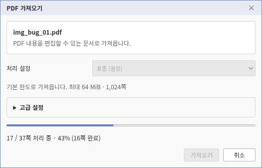

# PDF 가져오기 쪽별 진행 표시 검증

검증일: 2026-11-01 KST. 기준 커밋 `cbc9e1b3d57f3117df1fdf0b5ac3459132c807b1` + Rust diff SHA-256
`11742da4d07b0567a09d5bf3074a708cb891f9390e134810b391a9ecd1336a3f`.
최적화 WASM SHA-256 `8abeaa4b4d1eaece35b711525576409511718ea0893a05546fa7cc16b5a794c7`,
27,716,967바이트. release + wasm-opt -O, codegen-units 16.
생성 JS SHA-256 `e46821dc20d7e70294fabb97dfda0b829b5afef57cc0b6a9e00c0ba940344e96`.
pkg/public 파일 일치와 실제 브라우저의 WASM 응답 해시를 확인했다.



입력: `/mnt/e/tmp/img_bug_01.pdf`, 37쪽, SHA-256
`3fc955a5ceec37d0c5d83c28d09fce54a5fa2654884e82b5ecabe090f20e810b`.
실제 Worker에서 17쪽 처리 중, 16쪽 완료, floor(16/37×100)=43%인 상태를 캡처했다.
진행바의 value는 항상 설정되어 있으며 좌우로 반복 이동하는 불확정 표시가 아니다.
검증은 0%부터 100%까지 역행 없이 진행, 성공 시 37쪽 게시, 두 번째 요청의 중간 취소 후
기존 문서 세대 유지까지 확인했다. 기본 2쪽 8K 대조군도 같은 E2E를 통과했다.

직접 WASM에서는 37쪽의 시작·완료 알림 74건, 선택한 원본 2쪽의
`[sourcePage, sourcePageCount, completedPages, totalPages] = [2,2,0,1] → [2,2,1,1]`,
callback 오류 후 재사용 거부·새 요청 복구를 확인했다.
37쪽 HWPX는 진행 알림 추가 전 Native 결과와 바이트 단위로 같았다:
`9f95032e0f99c8b224b5ccb75ad84b843d11408fb7635e55b59a9fb9c1926710`.
진행 관찰만 추가했으며 새 조판·시각 golden은 등록하지 않았다.

재현:

```bash
# 저장소 루트에서 최적화 WASM 빌드·동기화 후 Studio 서버 실행
cd rhwp-studio
RHWP_PDF_PROGRESS_INPUT=/mnt/e/tmp/img_bug_01.pdf RHWP_PDF_PROGRESS_PAGES=37 \
  node e2e/pdf-page-progress-issue8413.test.mjs --mode=headless
# 공개 2쪽 대조군: 위 두 환경변수 없이 같은 테스트 실행
```

이번 실행에는 `RHWP_WASM_BUILD_MANIFEST`로 빌드 manifest도 지정했다.
실행 로그·74건 원본 이벤트·프로토콜/저장 비교 결과는
`output/pdf-import-errors-20261031/page-progress-*`에 기록했다.
대화창 UI 증거이며 기존 PDF 문자 간격 차이나 #8413–#8416 전체 완료 판정이 아니다.
